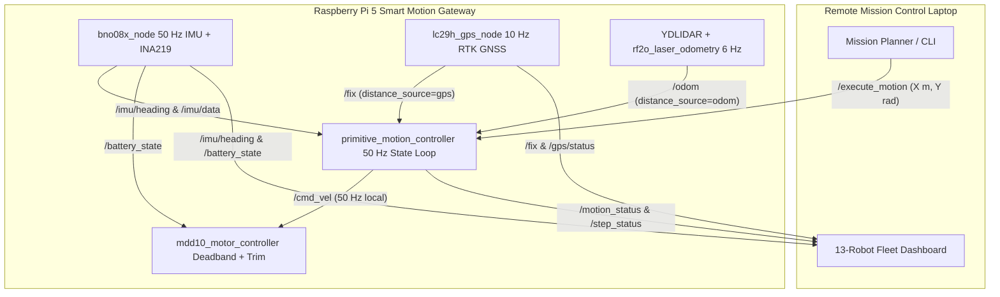

# Remote-Brain & State-Driven Control Architecture Guide

This document details the **Remote-Brain Offloaded Compute Architecture** and **Unified State-Driven Motion Control System** used in the ROS 2 Cone Robot workspace.

---

## 1. Architectural Concept

- **Ubuntu / Remote Station (The Mission Brain)**:
  - Runs the 13-Robot Fleet Dashboard (`tools/fleet_dashboard/app.py`), Foxglove Studio, and high-level waypoint/mission planning.
  - Sends high-level spatial goals (`Move X meters`, `Turn Y radians`, or `Drive Arc (X, Y)`) via the `/execute_motion` ROS 2 Action Server (or `/cmd_primitive` / `/cmd_step` topics).
  - Never streams raw high-frequency motor PWM or open-loop timed velocity commands over Wi-Fi.

- **Raspberry Pi 5 (Smart Motion Gateway — 1 GB RAM Edition)**:
  - Runs the **50 Hz State-Driven Motion Primitive Controller** (`primitive_motion_controller`) locally on the Pi, completely isolating motor control from Wi-Fi jitter.
  - Controls motion strictly as a function of **measured physical distance $s$ and measured IMU heading $\psi$** (never open-loop wall-clock timers).
  - Switching between the **GPS Robot** and the **LiDAR Robot** changes **only one parameter** (`distance_source: "gps"` vs `"odom"`, or `robot_type:=gps` vs `robot_type:=lidar` in `robot.launch.py`).

---

## 2. System Data Flow

---

## 3. Active ROS 2 Nodes & Topic Registry

### Active Nodes in `cone_robot_control`
| Executable | Purpose |
| :--- | :--- |
| **`primitive_motion_controller`** | 50 Hz state-driven action server (`/execute_motion`) and topic controller (`/cmd_primitive`, `/cmd_step`) for `STRAIGHT`, `ROTATE`, and `ARC` maneuvers. |
| **`mdd10_motor_controller`** | Converts `/cmd_vel` into left/right Cytron MDD10 PWM + DIR signals using effective skid-steer track width ($L_{\text{eff}}$), static deadband compensation (`min_pwm`), motor trim, and INA219 battery voltage scaling. |
| **`bno08x_node`** | 50 Hz 6-DOF Game Rotation Vector IMU driver (`/imu/data`, `/imu/heading` in CCW+ degrees) and 1 Hz INA219 battery monitor (`/battery_state`). |
| **`lc29h_gps_node`** | 10 Hz dual-band RTK GNSS driver (`/fix`, `/gps/status`) with integrated auto-discovering NTRIP client. |

### Standard Topic & Action Interfaces
| Interface Name | Type | Publisher / Client | Subscriber / Server | Purpose |
| :--- | :--- | :--- | :--- | :--- |
| `/execute_motion` | `cone_robot_interfaces/action/ExecuteMotion` | Mission Planner / CLI | `primitive_motion_controller` | Execute `STRAIGHT` (0), `ROTATE` (1), `ARC` (2), or `STOP` (3) with real-time spatial feedback. |
| `/cmd_primitive` | `geometry_msgs/msg/Vector3` | Laptop / CLI | `primitive_motion_controller` | Quick primitive trigger (`x` = distance in meters, `z` = delta yaw in radians). |
| `/cmd_step` | `geometry_msgs/msg/Vector3` | Laptop / CLI | `primitive_motion_controller` | Quick step trigger (`x` = distance in cm, `z` = delta yaw in degrees). |
| `/cmd_vel` | `geometry_msgs/msg/Twist` | `primitive_motion_controller` | `mdd10_motor_controller` | Internal 50 Hz closed-loop linear ($v_x$) and angular ($\omega_z$) velocity command. |
| `/imu/heading` | `std_msgs/msg/Float32` | `bno08x_node` | `primitive_motion_controller` | Continuous $[0, 360^\circ)$ CCW+ heading. |
| `/imu/data` | `sensor_msgs/msg/Imu` | `bno08x_node` | `primitive_motion_controller` | 50 Hz orientation quaternion and angular velocity ($\omega_z$). |
| `/fix` | `sensor_msgs/msg/NavSatFix` | `lc29h_gps_node` | `primitive_motion_controller` | RTK GNSS position used when `distance_source: "gps"`. |
| `/odom` | `nav_msgs/msg/Odometry` | `rf2o_laser_odometry` | `primitive_motion_controller` | 2D laser scan-matching odometry used when `distance_source: "odom"`. |
| `/battery_state` | `sensor_msgs/msg/BatteryState` | `bno08x_node` | `mdd10_motor_controller` | 3S LiPo bus voltage for feedforward PWM scaling and dashboard telemetry. |
